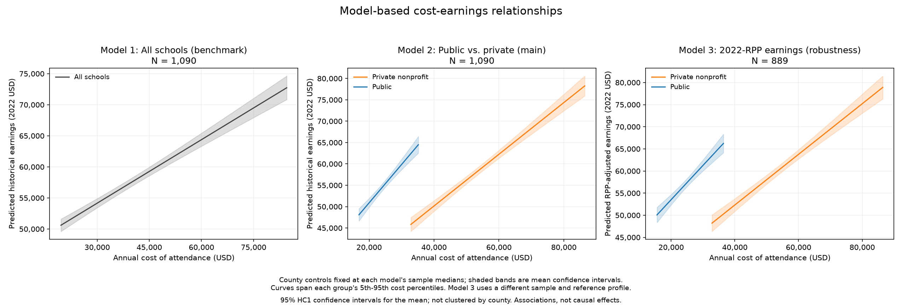
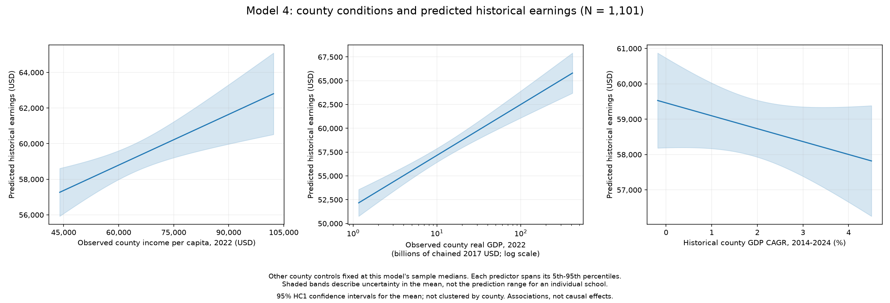
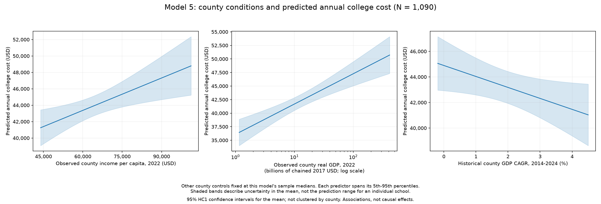

# Cost vs. Earnings by College

**Do more expensive colleges have higher reported earnings? Which schools have higher earnings relative to their published costs?**

### Group: Bevo-Git-Salary

**Report 1 — Observed 2022 county conditions and regional prices**

This report uses the current [regression results](artifacts/regression_results.txt) and nine figures in `artifacts/figures/`. County income, county GDP levels, and Regional Price Parities (RPP) use observed 2022 values. Scorecard earnings were measured in 2020–2021 and expressed in 2022 dollars; college costs retain their own reporting year. The GDP growth measure covers 2014–2024.

# Goal of the analysis

We examine the relationship between published college costs and median earnings ten years after entry. We also compare public and private nonprofit schools and ask whether county economic conditions are associated with college costs and earnings.

The main questions are:

- Are higher annual college costs associated with higher reported earnings after accounting for county conditions?
- Does the cost–earnings relationship differ between public and private nonprofit schools?
- Does the pattern remain when earnings are adjusted for local prices?
- How are county income, the size of the county economy, and county GDP growth related to costs and earnings?

The results describe associations among schools in the sample. They do not estimate the earnings gain caused by attending a particular college.

# Source of datasets

| Source | File used | What we take | Join key / year |
| --- | --- | --- | --- |
| College Scorecard, U.S. Department of Education | `data/raw/scorecard_raw.csv` | School characteristics, published cost of attendance, and median earnings | UNITID; `latest.` fields have different reporting years |
| BEA Regional Price Parities | `data/raw/2022 rpp.xlsx` | Metropolitan all-items price index, U.S. average = 100 | CBSA; 2022 |
| HUD Fair Market Rents | `data/raw/FY22_FMRs_revised.xlsx` | One- and two-bedroom benchmark rents | County FIPS; FY2022 |
| BEA GDP by County | `data/raw/CAGDP1__ALL_AREAS_2001_2024.csv` | Real GDP levels and growth | County FIPS; analysis level from 2022, CAGR from 2014–2024 |
| BEA Personal Income by County | `data/raw/CAINC1__ALL_AREAS_1969_2024.csv` | Per-capita personal income | County FIPS; analysis level from 2022 |
| HUD USPS ZIP–County Crosswalk | `data/raw/ZIP-COUNTY_062026.xlsx` | ZIP-to-county mapping using address shares | ZIP; June 2026 crosswalk |
| Census metropolitan and micropolitan delineations | `data/raw/metropolitan.xlsx` | County-to-CBSA mapping | County FIPS; March 2020 delineations |

The geographic lookup dates differ from the economic data years. In particular, using a 2026 ZIP crosswalk does not turn the earnings or county economic observations into 2026 data.

# Part A — College Scorecard (Sehun)

## Important cleaned columns

The school-level table is saved as `data/processed/scorecard.csv`.

| Column | Meaning and use | Unit / reporting basis |
| --- | --- | --- |
| `unitid` | Institution identifier used to join school tables | String |
| `name`, `city`, `state`, `zip5`, `lat`, `lon` | School identity and campus location; ZIP supports county matching | Text, five-digit ZIP, and coordinates |
| `control`, `ownership` | Public or private nonprofit comparison group; ownership codes 1 and 2 are retained | Category / code |
| `predominant_degree` | Predominant degree awarded; code 3 selects bachelor's-focused schools | Code |
| `enrollment` | Degree/certificate-seeking undergraduate headcount, including full- and part-time students; sample requires at least 1,000 | Students |
| `coa_published` | Published annual attendance cost, including tuition, fees, books, supplies, and estimated living expenses; main cost variable | USD in its original reporting year |
| `earnings_10yr` | Median annual earnings ten years after entry among covered former students who are working and not enrolled; main outcome | 2020–2021 observations in 2022 dollars |
| `earnings_6yr` | Corresponding earnings measure six years after entry; retained for comparison | 2020–2021 observations in 2022 dollars |
| `net_price` | Average attendance cost after grants and scholarships for the covered student cohort; loans are not deducted | Annual USD; retained, but not used in current regressions |
| `tuition_in_state`, `tuition_out_of_state` | Published tuition and fees by residency status | Annual USD; already included in COA |
| `admission_rate`, `completion_rate` | Admission share and first-time, full-time completion within 150% of normal time, typically six years for a four-year degree | Fractions from 0 to 1; retained institutional measures |
| `pell_rate`, `median_debt` | Pell Grant recipient share and median reported federal loan principal | Fraction / USD; retained aid measures |

## Sources and collection

The [College Scorecard institution documentation](https://collegescorecard.ed.gov/files/InstitutionDataDocumentation.pdf) describes institution-reported IPEDS data and federal student-aid records linked to tax-based earnings. Earnings entry cohorts include both completers and noncompleters. The [official glossary](https://collegescorecard.ed.gov/data/glossary/) explains enrollment, cost, aid, and completion measures.

Following the [API documentation](https://collegescorecard.ed.gov/data/api-documentation/), `01-collect_scorecard.py` requests 20 fields in pages of 100 schools and saves `scorecard_raw.csv`. The included download contains **6,273 records**. Script `02-clean_scorecard.py` standardizes names and identifiers and retains bachelor's-focused public/private nonprofit institutions with at least 1,000 students and available ten-year earnings. The cleaned sample contains **1,162 schools: 523 public and 639 private nonprofit**; 11 lack COA.

The API's `latest.` fields can refer to different years. The earnings dollar basis does not make every school feature a 2022 observation. This download contains institutional summaries, rather than individual student backgrounds, detailed major-specific outcomes, hours worked, employment destinations, or individual expenses.

## Limitations and improvements

1. **Limited representativeness:** Earnings cover federally aided former students who are working and not enrolled, and some observations are suppressed for privacy. They do not represent all students or all graduates. **Improvement:** Expand earnings coverage where possible, compare included and excluded institutions, and assess potential selection bias.

2. **Differences in student characteristics:** Earnings may reflect students' prior abilities, backgrounds, and fields of study as well as institutional differences. School-level admission and aid summaries cannot fully separate these influences. **Improvement:** Incorporate existing institutional controls where appropriate and add student-background and field-of-study data to compare more similar students and majors.

# Part B — Cost of Living (Linda Wu)

## Important cleaned columns

Regional prices are saved in `rpp_clean.csv`, county rent benchmarks in `hud_fmr_clean.csv`, and school-linked prices in `college_rpp_adjusted.csv`. The combined `schools.csv` also contains the auxiliary rent and matching fields.

| Column | Meaning and use | Unit / year |
| --- | --- | --- |
| `county_fips` | County identifier for geographic and HUD rent joins | Five-digit string |
| `cbsa`, `cbsa_name`, `area_type` | Core Based Statistical Area code, name, and metropolitan/micropolitan classification | March 2020 delineations |
| `metro_name` | Name of the metropolitan area in the BEA price table | Text |
| `rpp_2022` | All-items regional price index used to adjust earnings for local price differences | 2022 index; U.S. average = 100 |
| `earnings_6yr_rpp_adj`, `earnings_10yr_rpp_adj` | Reported earnings divided by `rpp_2022 / 100`; the ten-year measure is used in analysis | Regionally adjusted annual earnings |
| `fmr_1br`, `fmr_2br` | Unweighted county averages of HUD one-/two-bedroom gross-rent benchmarks | FY2022 USD per month per rental unit |
| `hud_record_count` | Number of HUD source records averaged within a county | Count; the resulting county mean is not a newly estimated rent percentile |
| `missing_cbsa`, `missing_rpp`, `missing_hud` | Flags indicating absent CBSA, RPP, or two-bedroom HUD rent matches | Boolean flags in the combined school table |

## Sources and collection

We use downloaded BEA, HUD, and Census workbooks. BEA constructs RPP from BLS consumer-price observations, Census American Community Survey housing data, and consumption expenditure weights. It describes prices across regions relative to the national average, rather than a student-specific spending budget. See [BEA RPP methodology](https://apps.bea.gov/scb/issues/2022/03-march/0322-rpp.htm) and [the 2022 RPP release explanation](https://apps.bea.gov/scb/issues/2024/05-may/0524-regional-price-parities.htm).

HUD Fair Market Rents estimate the 40th percentile of monthly gross rents for standard-quality rental units. Gross rent includes rent and tenant-paid utilities. The FY2022 estimates use earlier ACS rent data updated with inflation and trend factors, rather than a survey of every student's actual 2022 expenses. See [HUD FY2022 data](https://www.huduser.gov/portal/datasets/fmr.html#2022_query) and [the FY2022 methodology notice](https://www.federalregister.gov/documents/2021/08/06/2021-16148/fair-market-rents-for-the-housing-choice-voucher-program-moderate-rehabilitation-single-room).

Scripts `07` and `08` retain the 2022 all-items RPP series, standardize geographic codes, and average HUD records by county, producing **387 metropolitan price indices** and **3,227 county rent records**. Scripts `09–10` use [Census historical delineations](https://www.census.gov/geographies/reference-files/time-series/demo/metro-micro/historical-delineation-files.html) to assign CBSAs. Scripts `11–12` left-join these measures while preserving all 1,162 schools: **914 have RPP values and 248 do not; 1,144 have HUD rent matches and 18 do not**. The missing rent matches are in Connecticut.

RPP adjusts earnings by dividing by `rpp_2022 / 100`. Neither RPP nor HUD rent is added to COA. HUD rents and matching flags support auxiliary checks; they do not enter the current regressions or metrics. These area-level tables do not record students' actual housing arrangements, consumption, or out-of-pocket payments.

## Limitations and improvements

1. **Estimated vs. actual costs:** Regional price indices and housing benchmarks may not reflect actual student expenses, roommates, commuting, or neighborhood differences. County averaging also hides local variation. **Improvement:** Add campus- or neighborhood-level housing prices and student living-expense data.

2. **Incomplete geographic coverage:** Some schools lack regional cost-of-living matches, reducing the sample available for price-adjusted analysis. **Improvement:** Evaluate clearly identified alternative measures for unmatched locations, such as state or nonmetropolitan price estimates, and compare results across matched and unmatched schools.

3. **Gross vs. net costs:** Published COA is measured before grants and scholarships and may overstate students' actual financial burden. **Improvement:** Use the already collected `net_price` in additional analyses and incorporate more detailed financial-aid and income-specific net-price data.

# Part C — County Economic Data (Edward)

## Important cleaned and derived columns

County levels and growth measures are saved in `local_economic_data.csv` and `local_income_data.csv`, then joined to schools in `SCHOOL_INCOME_LOCALGDP.csv`.

| Column | Meaning and use | Unit / year |
| --- | --- | --- |
| `county_fips` | County assigned to a school's ZIP and used to join BEA data | Five-digit string |
| `gdp_2022` | Total real economic output produced in the county; the selected GDP level | Thousands of chained 2017 USD; observed 2022 |
| `income_2022` | County personal income divided by resident population; an average across residents, not a graduate earnings measure | Nominal 2022 USD per resident |
| `log_gdp_2022` | Natural logarithm of positive `gdp_2022`, created in the analysis script | A GDP doubling changes this variable by `ln(2)` |
| `GDP_growth_10y_CAGR` | Annual compound GDP growth: `((gdp_2024 / gdp_2014) ** (1 / 10) - 1) * 100` | Percent per year over 2014–2024; one unit is one percentage point |
| `gdp_YYYY`, `income_YYYY` | Retained historical GDP and per-capita income levels for 2010–2024 | Respective GDP and income units above |
| `GDP_growth_10y_avg`, `income_growth_10y_avg`, `income_growth_10y_CAGR` | Additional ten-year growth summaries retained in the county tables | Percent; not included in the current five regressions |

## Sources and collection

BEA estimates county GDP from compensation, business-income components, and other industry information, drawing on payroll, business, and administrative data. It measures production in the county. County personal income combines residents' earnings, property income, and transfers; per-capita income divides that total by resident population. It is not a median wage. See [BEA county GDP methodology](https://apps.bea.gov/scb/issues/2020/03-march/0320-county-level-gdp.htm) and [County Personal Income: Concepts and Methods](https://www.bea.gov/system/files/methodologies/BEA-County-Personal-Income-Concepts-and-Methods.pdf).

The project uses downloaded `CAGDP1` and `CAINC1` CSVs. Scripts `04–05` remove footer and aggregate records, retain real GDP (`LineCode == 1`) and per-capita income (`LineCode == 3`), and keep 2010–2024 levels. They calculate annual growth for 2015–2024, ten-year averages, and CAGR. The cleaned files contain **3,127 GDP county records** and **3,149 income county records**.

For geographic matching, the [HUD USPS crosswalk](https://www.huduser.gov/portal/datasets/usps_crosswalk.html) uses quarterly USPS address records to relate ZIP codes to counties. Script `03` uses `ZIP-COUNTY_062026.xlsx`, selecting the county with the highest total address share for each ZIP and filling nine remaining school counties with explicit overrides. This assigns a county to every school, but a ZIP can span counties; the selected county is not a precise campus-location measurement. Script `06` then joins GDP and income by county FIPS.

The analysis uses observed 2022 income and GDP together with the 2014–2024 GDP CAGR. **1,101 schools have the required county controls; 61 lack them.** These aggregate data do not identify former students' employment destinations, occupations, or individual labor-market outcomes.

## Limitations and improvements

1. **Geographic mismatch:** College location does not necessarily represent where former students work or live, so campus-county conditions may poorly describe their employment opportunities. **Improvement:** Incorporate graduate employment locations and local labor-market measures, such as occupational wages, employment, and unemployment.

2. **Temporal inconsistency:** The project combines a June 2026 ZIP crosswalk, March 2020 CBSA delineations, observed 2022 county levels, and a 2014–2024 growth window. Earnings and costs also have different reporting periods. **Improvement:** Align economic and geographic vintages where possible, use growth periods available before the outcome being studied, and document remaining differences.

3. **Incomplete geographic matching:** Having a county FIPS does not ensure a BEA match. The 61 schools missing county controls are in Puerto Rico (23), Connecticut (18), Virginia (18), Guam (1), and the U.S. Virgin Islands (1). **Improvement:** Validate assignments using available campus coordinates, reconcile county-equivalent codes, seek comparable data for uncovered locations, and document excluded observations and their characteristics.

# Part D — Analysis (Harper)

## 1. Research Questions

The analysis asks whether higher published college costs are associated with higher median earnings ten years after entry, and whether this relationship differs between public and private nonprofit schools.

We address five related questions:

1. Is annual cost positively associated with earnings after accounting for county economic conditions?
2. Does the cost–earnings slope differ between public and private nonprofit schools?
3. Does that pattern also appear when earnings are adjusted for regional prices?
4. How are county income, GDP levels, and GDP growth associated with earnings and college costs?
5. How do earnings-to-cost ratios compare between the two school groups?


The descriptive scatter shows an upward cost–earnings pattern in both groups, with public schools concentrated at lower costs. Its fitted lines do not control for county conditions. The regressions below examine those adjusted associations.

## 2. Methodology

We join `college_rpp_adjusted.csv` and `SCHOOL_INCOME_LOCALGDP.csv` by school ID, producing **1,162 school observations**. Each school receives equal weight. Each model uses the observations complete for its own variables, so sample sizes differ.

The five models use ordinary least squares (OLS) with **HC1 heteroskedasticity-robust standard errors**. We report sample sizes, R², adjusted R², estimated associations, and p-values. A 5% significance threshold is used unless stated otherwise. Full coefficient and standard-error tables are available in [regression_results.txt](artifacts/regression_results.txt).

All five models include these county controls:

- `income_2022`: observed county per-capita income, in nominal USD.
- `log_gdp_2022`: the natural logarithm of observed county real GDP, originally measured in thousands of chained 2017 USD.
- `GDP_growth_10y_CAGR`: annual compound GDP growth over 2014–2024, expressed in percent.

Dollar contrasts below hold the model's other predictors fixed. A GDP doubling corresponds to the log-GDP coefficient multiplied by `ln(2)`; a one-unit increase in the growth variable is one percentage point.

Models 2 and 3 include an interaction between cost and school type. Private nonprofit schools are the reference group; the public cost slope equals the cost coefficient plus the public interaction coefficient. Model 3 divides earnings by `rpp_2022 / 100`. COA itself remains in its original reporting-year dollars.

Regression curves hold other predictors at each model's estimation-sample medians. Shaded bands are **95% HC1 confidence intervals for the conditional mean**, rather than prediction intervals for an individual school or student. The displayed cost curves span each group's 5th–95th cost percentiles.

For the cost-efficiency comparison, we calculate:

```text
annual_cost = coa_published
total_cost_4yr = annual_cost * 4
payback_years = total_cost_4yr / earnings_10yr
efficiency = earnings_10yr / annual_cost
efficiency_rpp = earnings_10yr_rpp_adj / annual_cost
```

These are descriptive ratios calculated in memory. COA already includes estimated living expenses, so HUD rents are not added to it. The payback ratio is not an estimate of an individual's financial break-even date.

## 3. Models and Results

### Model 1 — Cost and earnings: pooled benchmark

**Question:** Across the sample, is higher annual COA associated with higher earnings after accounting for county conditions?

**Specification:**

```text
earnings_10yr ~ coa_published + income_2022 + log_gdp_2022
               + GDP_growth_10y_CAGR
```

**Sample and fit:** N = **1,090**; R² = **0.3735**; adjusted R² = **0.3711**.

| Predictor change | Associated difference in annual earnings | p-value |
| --- | ---: | ---: |
| Annual COA +$10,000 | +$3,406 | <0.001 |
| County per-capita income +$10,000 | +$539 | 0.02981 |
| County real GDP doubles | +$1,016 | <0.001 |
| County GDP CAGR +1 percentage point | −$90 | 0.7002 |

**Finding:** Higher costs are positively associated with earnings in this pooled model. The cost coefficient is **0.3406**, or approximately $3,406 higher annual earnings per $10,000 higher annual COA; its 95% HC1 interval is **$3,016 to $3,796** for that contrast. County income and GDP levels also have positive associations. The growth coefficient provides insufficient evidence of a nonzero association at the 5% level.

### Model 2 — Public vs. private nonprofit: main comparison

**Question:** Does the cost–earnings slope differ between public and private nonprofit schools?

**Specification:**

```text
earnings_10yr ~ coa_published * control + income_2022
               + log_gdp_2022 + GDP_growth_10y_CAGR
```

**Sample and fit:** N = **1,090**; R² = **0.4857**; adjusted R² = **0.4828**.

| School group / comparison | Earnings difference per $10,000 higher annual COA | 95% HC1 confidence interval |
| --- | ---: | ---: |
| Private nonprofit | +$6,051 | $5,382 to $6,719 |
| Public | +$8,965 | $7,343 to $10,588 |
| Public minus private slope | +$2,915 | $1,163 to $4,667 |

**Finding:** The private nonprofit cost coefficient is **0.6051**, and the public interaction is **+0.2915** (`p = 0.001111`). Using the unrounded coefficients, the public slope is approximately **0.8965**. The positive interaction supports a steeper cost–earnings slope for public schools in this specification.

The public-slope confidence interval uses the full HC1 covariance matrix. The public-school indicator describes the group difference at zero COA; it should not be read as an overall public-school earnings premium.

County GDP remains positively associated with earnings (`p < 0.001`). County income has `p = 0.0671`, and growth has `p = 0.6792`; neither meets the 5% threshold in this model.

### Model 3 — RPP-adjusted earnings

**Question:** Does the public/private pattern also appear after adjusting earnings for regional price differences?

**Specification:**

```text
earnings_10yr_rpp_adj ~ coa_published * control + income_2022
                       + log_gdp_2022 + GDP_growth_10y_CAGR
```

**Sample and fit:** N = **889**; R² = **0.3703**; adjusted R² = **0.3660**.

| School group / comparison | Adjusted earnings difference per $10,000 higher annual COA | 95% HC1 confidence interval |
| --- | ---: | ---: |
| Private nonprofit | +$5,721 | $4,974 to $6,468 |
| Public | +$7,745 | $6,129 to $9,362 |
| Public minus private slope | +$2,024 | $253 to $3,796 |

**Finding:** The private cost coefficient is **0.5721**, and the public interaction is **+0.2024** (`p = 0.02512`), giving a public slope of approximately **0.7745**. Positive cost slopes and a steeper public slope also appear in this price-adjusted sample.

None of the county controls meets the 5% threshold: income has `p = 0.3533`, log GDP `p = 0.497`, and growth `p = 0.08621`. The growth association meets only the 10% threshold.

Model 3 changes both the outcome scale and the estimation sample. Its differences from model 2 therefore cannot be attributed solely to regional price adjustment; a comparison on the same sample is still needed.



The three panels display models 1, 2, and 3 in order. Each uses its own sample's reference values. The figure is shown once to compare the fitted relationships after presenting each model's results.

### Model 4 — County conditions and earnings

**Question:** How are county economic conditions associated with earnings without including college cost or school type?

**Specification:**

```text
earnings_10yr ~ income_2022 + log_gdp_2022 + GDP_growth_10y_CAGR
```

**Sample and fit:** N = **1,101**; R² = **0.1459**; adjusted R² = **0.1436**.

| Predictor change | Associated difference in annual earnings | p-value |
| --- | ---: | ---: |
| County per-capita income +$10,000 | +$950 | 0.0008122 |
| County real GDP doubles | +$1,609 | <0.001 |
| County GDP CAGR +1 percentage point | −$365 | 0.1665 |

**Finding:** Schools in counties with higher per-capita income and larger real GDP tend to report higher earnings, holding the other county variables fixed. The model does not provide sufficient evidence of a nonzero growth association at the 5% level.



The income and GDP curves rise, while the growth curve has a negative estimate with substantial uncertainty. The model explains approximately **14.59%** of the sample variation in earnings.

### Model 5 — County conditions and college costs

**Question:** How are county economic conditions associated with published annual college costs?

**Specification:**

```text
coa_published ~ income_2022 + log_gdp_2022 + GDP_growth_10y_CAGR
```

**Sample and fit:** N = **1,090**; R² = **0.0862**; adjusted R² = **0.0837**.

| Predictor change | Associated difference in annual COA | p-value |
| --- | ---: | ---: |
| County per-capita income +$10,000 | +$1,315 | 0.004262 |
| County real GDP doubles | +$1,682 | <0.001 |
| County GDP CAGR +1 percentage point | −$858 | 0.03477 |

**Finding:** Higher county income and larger GDP are associated with higher annual COA. Conditional on those levels, one percentage point higher GDP CAGR is associated with approximately **$858 lower annual COA**. This growth association meets the 5% threshold, unlike the growth terms in the earnings models.



The model explains approximately **8.62%** of the sample variation in costs, so these county characteristics leave most cost variation unexplained. The negative growth estimate does not identify a causal mechanism linking local growth to college pricing.

## 4. Cost-Efficiency Findings

The regression slopes describe earnings differences associated with costs; the earnings-to-cost ratios address the separate question of how reported earnings compare with published costs.

| Median school-level measure | Public | Private nonprofit |
| --- | ---: | ---: |
| Annual published COA | $25,165 | $56,692 |
| Four-year published cost | $100,660 | $226,768 |
| Earnings ten years after entry | $54,338 | $58,561 |
| Simple payback ratio, in years | 1.89 | 3.75 |
| Earnings / annual COA | 2.12 | 1.07 |
| RPP-adjusted earnings / annual COA | 2.26 | 1.06 |

Public schools have lower median published costs and higher median earnings-to-cost ratios in this sample. These are medians of school-level measures, using each measure's available observations, rather than ratios of group medians. Nominal cost-based metrics are available for 516 public and 635 private nonprofit schools; RPP-adjusted ratios are available for 378 and 525.

These group comparisons do not establish which individual school is best for a particular student. Additional distribution and geographic scatter plots are provided in [Appendix: Supporting Descriptive Figures](appendix_figures.md).

## 5. Limitations of Analysis

1. **Correlation vs. Causation:** OLS identifies associations between college costs, county economic conditions, and reported earnings. It cannot establish that spending more on college or attending a particular school causes higher earnings.

2. **Omitted Variable Bias:** Student abilities, family backgrounds, fields of study, and institutional quality may influence earnings and costs, but are not fully controlled for in the current models. Public/private differences may partly reflect these omitted characteristics.

3. **Temporal Mismatch:** The 2014–2024 GDP growth measure includes years after the earnings observation period of 2020–2021, limiting its interpretation as a predictor. County levels are from 2022, while COA retains its own reporting year; costs and earnings are not fully aligned in either observation year or price basis.

The models also use different complete-case samples, particularly after requiring RPP. HC1 standard errors are not clustered by county and do not account for possible dependence among schools in the same county. The payback and efficiency measures are simple ratios; they omit foregone earnings, financing costs, taxes, and an earnings counterfactual, and should not be interpreted as individual investment returns.

## 6. Extensions & Future Research

1. **Additional Control Variables:** Incorporate student backgrounds, fields of study, and institutional characteristics to reduce omitted variable bias. Use the existing net-price and aid measures in further cost comparisons and add more detailed student and major information where available.

2. **Panel Data Analysis:** Collect multi-year data on college costs, earnings, and regional conditions to examine changes over time. Align cohorts, price years, and geographic definitions, and consider school and year fixed-effects models where appropriate.

3. **Alternative Model Specifications:** Test GDP growth windows that precede the outcome period, different control-variable combinations, and logarithmic specifications. Compare nominal and RPP-adjusted outcomes on the same sample, examine influential observations, and assess inference with standard errors clustered by county.

# Reproduce it

See [RUN_GUIDE.md](RUN_GUIDE.md) for instructions on running the project.

# Team & files

| Part | Member | Scripts |
| --- | --- | --- |
| A — Scorecard | Sehun | `src/01-collect_scorecard.py`, `src/02-clean_scorecard.py` |
| B — Cost of living and geography | Linda Wu | `src/07-clean_rpp.py`, `src/08-collect_cost_of_living.py`, `src/09-clean_county_cbsa.py`, `src/10-assign_college_cbsa.py`, `src/11-merge_college_rpp.py`, `src/12-merge.py` |
| C — County economics | Edward | `src/03-fips-zip_pairup.py`, `src/04-GDP_Clean.py`, `src/05-Income_Clean.py`, `src/06-GDP-Income-addtoScorecard.py` |
| D — Analysis | Harper | `src/13-analysis.py` |

`data/raw/` contains source downloads; `data/processed/` contains cleaned and merged tables; `artifacts/` contains the regression tables and figures used in this report.
