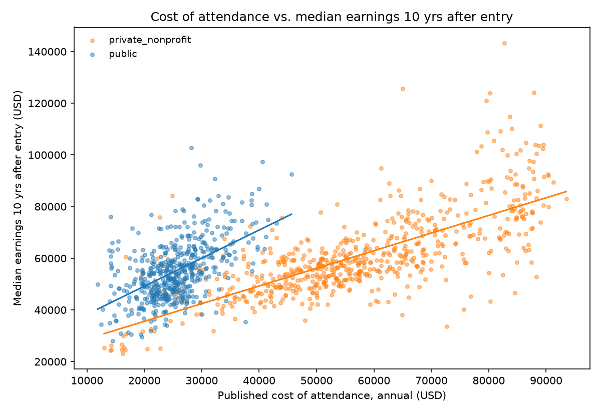
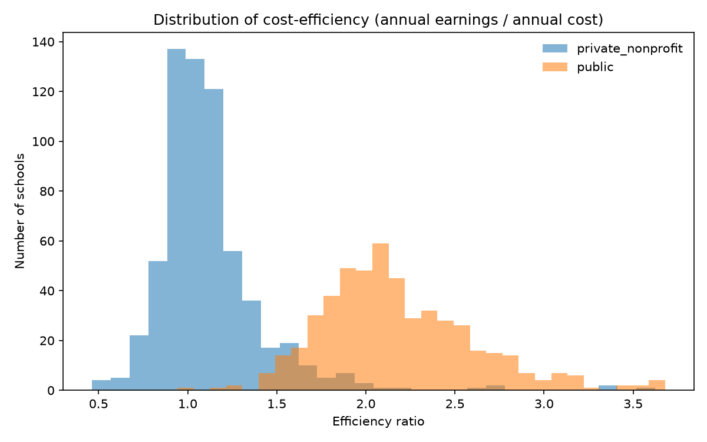
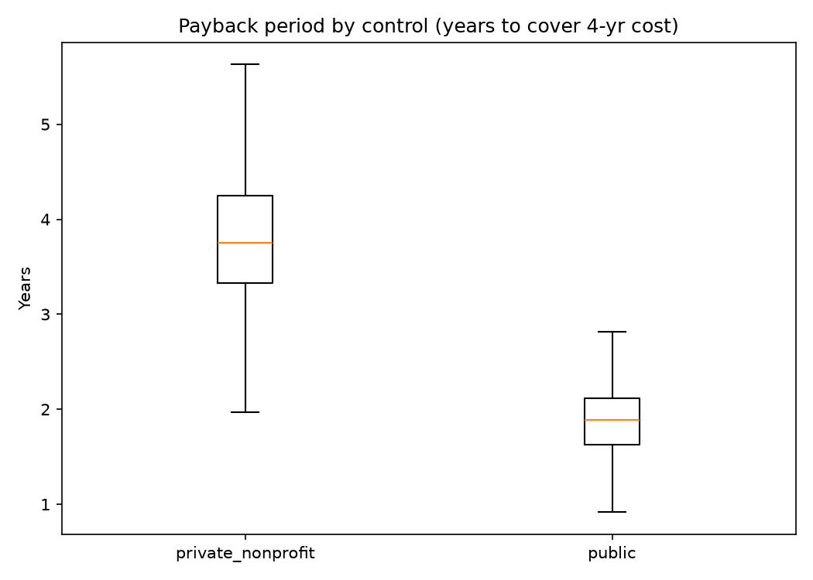
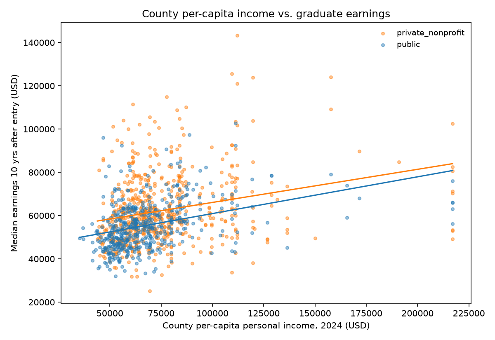
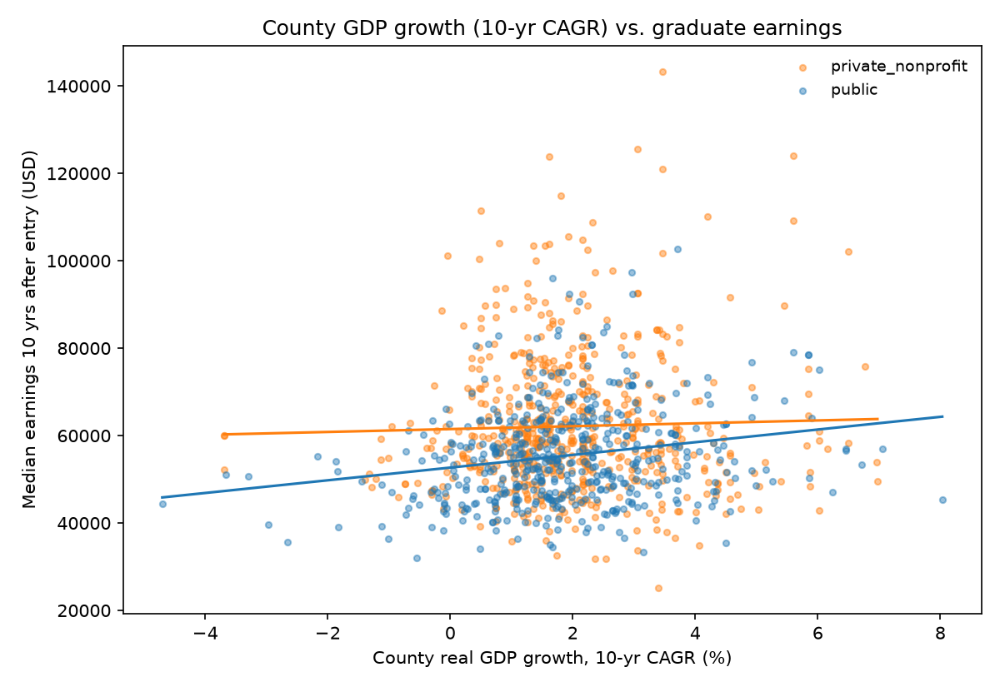

# Cost vs. Earnings by College

**Do more expensive colleges deliver higher earnings? Which schools give the best return per dollar?**

### Group: Bevo-Git-Salary

# Goal of the analysis

We ask whether colleges that cost more (tuition plus local living costs) deliver higher post-graduation earnings, and which schools are most cost-efficient. Three sub-questions follow the main one:

- Does the cost–earnings relationship differ between public and private schools?
- Do colleges in richer or faster-growing counties charge more, or produce higher-earning graduates?
- (Side check, dropped) How far do schools' published Cost of Attendance figures differ from Scorecard cost figures? The planned web-scraping validation was dropped by team decision — crawling ~30 school sites was too uncertain — and replaced with county economic data.

# Source of datasets

| Source | What we take | Join key |
|--------|--------------|----------|
| College Scorecard, U.S. Dept. of Education (API) | Tuition (in/out-of-state), net price, published cost of attendance (COA), median earnings 6 & 10 yrs after entry, control (public/private), enrollment, admission & completion rates, debt, Pell rate, location | UNITID |
| BEA Regional Price Parities (RPP), 2024 | Metro-area price index (U.S. average = 100) | CBSA |
| HUD Fair Market Rents, FY2024 | 1BR/2BR benchmark rents, averaged to county level | County FIPS |
| BEA GDP by County (CAGDP) | Real GDP levels, yearly growth 2015–2024, 10-yr average & CAGR | County FIPS |
| BEA Personal Income by County (CAINC1) | Per-capita personal income, yearly growth 2015–2024, 10-yr average & CAGR | County FIPS |
| HUD USPS ZIP–County Crosswalk | ZIP → county mapping with address ratios | ZIP |

# Part A — Scorecard collection and cleaning (Sehun)

## Collect Scorecard data (`src/collect_scorecard.py`)

**Key functions:**

`fetch_page(api_key, page)`: Requests one page (100 schools) from the Scorecard API with a fixed field list.

`collect_all(api_key)`: Loops over pages until every school record is downloaded, then stacks them into one DataFrame.

**Processing logic:** The API key is read from `.env` (`SCORECARD_API_KEY`, never committed). Twenty fields are requested per school — identifiers (id, name, city, state, zip, ownership, predominant degree, lat/lon), size/selectivity (enrollment, admission rate, 4-yr completion rate), aid (median loan principal, Pell grant rate), costs (in-state/out-of-state tuition, average net price, published COA for the academic year), and outcomes (median earnings 6 and 10 years after entry). All pages are concatenated and saved raw to `data/raw/scorecard_raw.csv`.

## Clean and filter the sample (`src/clean_scorecard.py`)

**Key functions:**

`load_raw()`: Reads the raw CSV keeping school id and ZIP as strings so leading zeros survive.

`clean(df)`: Renames API fields to snake_case (`latest.cost.attendance.academic_year` → `coa_published`, etc.), builds a 5-digit `zip5`, and maps ownership codes 1/2/3 to `public` / `private_nonprofit` / `private_forprofit`.

`filter_sample(df)`: Keeps bachelor's-focused schools (`predominant_degree == 3`) that are non-profit (`ownership` in [1, 2]), enroll at least 1,000 students, and have non-suppressed 10-year earnings. **1,162 schools survive.**

`save_targets(df)`: Writes `unitid, name, city, state, zip5, control, lat, lon` to `data/processed/school_targets.csv` — the ID/location roster Parts B and C join against.

**Processing logic:** Rename → build ZIP → label control → filter → save `data/processed/scorecard.csv` (the base table everything else builds on) plus the targets roster.

## Column dictionary (`data/processed/scorecard.csv`)

| Column | Meaning | Unit |
| --- | --- | --- |
| `unitid` | Scorecard/IPEDS school ID (join key) | string |
| `name`, `city`, `state` | School name and location | text, 2-letter state |
| `zip5` | 5-digit ZIP built from `school.zip` | string |
| `control` | `public` or `private_nonprofit` (for-profit excluded) | category |
| `ownership` | Ownership code: 1 public, 2 private non-profit, 3 private for-profit | code |
| `predominant_degree` | Predominant degree awarded; 3 = bachelor's | code |
| `lat`, `lon` | School location | degrees |
| `enrollment` | Undergraduate enrollment | students |
| `admission_rate` | Share of applicants admitted | 0–1 |
| `completion_rate` | Completion rate within 150% of normal time (4-year schools) | 0–1 |
| `median_debt` | Median federal loan principal of students who left the school | USD |
| `pell_rate` | Share of undergraduates receiving Pell grants | 0–1 |
| `tuition_in_state` | Published in-state tuition and fees | USD per year |
| `tuition_out_of_state` | Published out-of-state tuition and fees | USD per year |
| `net_price` | Average net price after grant aid | USD per year |
| `coa_published` | Published cost of attendance (tuition, fees, books, living) | USD per year |
| `earnings_6yr` | Median earnings of working, not-enrolled students 6 years after entry | USD per year |
| `earnings_10yr` | Same measure, 10 years after entry (main outcome) | USD per year |

# Part B — Cost of living (Linda Wu)

A dollar buys different amounts in different places, so nominal earnings can't be compared directly. Part B attaches a local price level to every school and converts earnings into comparable ("real") dollars.

## Clean BEA Regional Price Parities (`src/clean_rpp.py`)

**Key functions:**

`clean_rpp()`: Reads `data/raw/RPP.xlsx` ("Table" sheet, header row 5), keeps `LineCode == 1` (the all-items index), zero-pads GeoFIPS to 5 digits, drops U.S. totals (`00000`/`00999`), and renames to `cbsa, metro_name, rpp_2024`.

**Processing logic:** Filter to the all-items price index → validate CBSA codes and positive values (asserted, duplicates rejected) → save `data/processed/rpp_clean.csv` (387 metro areas). RPP is an *index* (U.S. average = 100), never a dollar amount.

## Clean HUD Fair Market Rents (`src/collect_cost_of_living.py`)

**Key functions:**

`clean_hud_fmr()`: Reads `data/raw/hud_2024.xlsx` ("FY24_FMRs_rev" sheet), takes the 5-digit county FIPS from each record, and averages 1BR/2BR Fair Market Rents to the county level.

**Processing logic:** County-aggregate rents with record counts → assert unique, well-formed FIPS and positive rents → save `data/processed/hud_fmr_clean.csv` (3,228 counties). These are HUD *benchmarks*, not rents students actually pay.

## Build the geography maps (`src/clean_hud_crosswalk.py`, `src/clean_county_cbsa.py`)

**Key functions:**

`clean_hud_crosswalk()`: Reads the HUD ZIP–county crosswalk (`ZIP-COUNTY_122024.xlsx`), sorts by residential ratio, and keeps one county per ZIP — the one with the highest address share.

`clean_county_cbsa()`: Reads `data/raw/metropolitan.xlsx`, builds 5-digit `county_fips` from state + county codes, and keeps `cbsa, cbsa_name, area_type` (metropolitan vs micropolitan).

**Processing logic:** Two lookup tables are produced: `data/processed/zip_county_clean.csv` (39,490 ZIPs → county) and `data/processed/county_cbsa_clean.csv` (1,916 county → metro mappings).

## Assign metro areas to schools (`src/assign_college_cbsa.py`)

**Key functions:**

`assign_college_cbsa()`: Merges `scorecard_with_fips.csv` (from Part C's FIPS step) with the county→CBSA map on `county_fips` (`many_to_one`, row count asserted so no school is lost or duplicated).

**Processing logic:** Every school inherits its county's CBSA; schools whose counties sit outside any metro/micro area keep a missing CBSA and are reported by state → save `data/processed/school_geography.csv` (1,162 schools + `cbsa, cbsa_name, area_type`).

## Merge and price-adjust earnings (`src/merge_college_rpp.py`, `src/merge.py`)

**Key functions:**

`merge_college_rpp()`: Joins schools to RPP on `cbsa` and computes `earnings_6yr_rpp_adj` / `earnings_10yr_rpp_adj = earnings / (rpp_2024 / 100)`.

`merge_schools()` (`merge.py`): Joins school geography + RPP + HUD rents into `data/processed/schools.csv`; schools with no RPP match are listed in `data/processed/unmatched_schools.csv` (248 schools, mostly micropolitan areas outside RPP coverage).

**Processing logic:** 1,162 schools in, 1,162 out; 914 receive an RPP value and adjusted earnings, 248 do not — reported, not silently dropped.

# Part C — County economics (Edward)

Replaces the original COA web-scraping plan: instead of scraping ~30 school sites (too uncertain), Part C asks whether *where a college sits* matters — do schools in richer or faster-growing counties cost more or produce higher-earning graduates?

## Clean BEA GDP by county (`src/GDPCleaning.py`)

**Processing logic:** Reads `CAGDP1__ALL_AREAS_2001_2024.csv` (cp1252 encoding, BEA footer rows skipped) → keeps `LineCode == 1` (real GDP) and county-level rows only (GeoFIPS not ending in `000`) → drops years before 2010 → computes yearly growth rates 2015–2024, the 10-year average growth, and the 10-year CAGR → `data/processed/local_economic_data.csv` (3,127 counties). See `Working_Notes_PartC.md`.

## Clean BEA personal income by county (`src/INCOMECLEAN.py`)

**Processing logic:** Same pipeline on `CAINC1__ALL_AREAS_1969_2024.csv` keeping `LineCode == 3` (per-capita personal income): yearly income growth 2015–2024, 10-year average, 10-year CAGR → `data/processed/local_income_data.csv` (3,149 counties).

## Map schools to counties (`src/FIPSADD.py`)

**Processing logic:** Merges `scorecard.csv` with the HUD ZIP–county crosswalk (`ZIP-COUNTY_062026.xlsx`) on `zip5`; where a ZIP spans counties, the county with the highest total address ratio wins; invalid FIPS are nulled; 9 schools that still miss a county are assigned by hand (Berea, Nicholls State, Southern, Babson, NC State, Cincinnati, Tennessee Tech, SMU, Virginia State) → `data/processed/scorecard_with_fips.csv`.

## Final merge (`src/Final_Combine_For_PART_C.py`)

**Processing logic:** Left-joins the FIPS-tagged Scorecard table to the GDP and income tables on `county_fips` (`many_to_one`), renames year columns to `gdp_YYYY` / `income_YYYY`, and appends a merge summary as comments at the end of `data/processed/SCHOOL_INCOME_LOCALGDP.csv` (1,168 rows; 1,119 schools matched to *both* economic datasets, 43 unmatched — mainly Virginia and U.S. territories — documented for exclusion from regressions).

# Part D — Analysis (Harper)

Run with `venv/bin/python src/analysis.py`. Joins the Part B table (`college_rpp_adjusted.csv`: costs, RPP-adjusted earnings) with the Part C table (`SCHOOL_INCOME_LOCALGDP.csv`: county GDP/income) on `unitid` — 1,162 schools, full match after dropping 6 county rows with missing ids.

## Cost metrics (`add_metrics`)

**Definitions** (agreed by the team; Scorecard COA already bundles tuition + fees + books + living, so nothing is added on top — no double counting; RPP is only ever a divisor):

- `annual_cost = coa_published`
- `total_cost_4yr = coa_published × 4`
- `payback_years = total_cost_4yr / earnings_10yr` — years of median post-graduation earnings to cover the degree's sticker cost
- `efficiency = earnings_10yr / coa_published` — yearly earnings per yearly cost dollar; `efficiency_rpp` uses RPP-adjusted earnings

**Processing logic:** Compute the four metrics (11 schools lack COA → metrics undefined and reported); print median metrics by control and the 10 most cost-efficient schools; save `data/processed/college_metrics.csv`.

## Regressions (`run_regressions`)

**Key functions:**

`_fit(formula, df, subset)`: OLS via `statsmodels` with HC1 heteroskedasticity-robust standard errors (earnings variance fans out at high costs, so robust SEs keep inference honest).

**Specs and what each answers:**

1. `earnings_10yr ~ coa_published` — the main question: do pricier colleges deliver higher earnings? Quantifies the gradient.
2. `earnings_10yr ~ coa_published * control` — does the gradient differ for public vs private schools? The interaction lets each group have its own slope.
3. `earnings_10yr_rpp_adj ~ coa_published * control` — robustness: does the story survive price-level adjustment?
4. `earnings_10yr ~ income_2024 + GDP_growth_10y_CAGR` — does local prosperity/growth predict graduate earnings?
5. `coa_published ~ income_2024 + GDP_growth_10y_CAGR` — does local prosperity/growth predict college costs?

**Processing logic:** Drop missing rows per spec, fit, print coefficient tables with robust SEs and significance stars, save everything to `artifacts/regression_results.txt`.

## Figures (`make_figures`)

**Key functions:**

`_scatter_with_fit(ax, df, x, y, hue, ...)`: scatter by control group with a per-group OLS fit line (`numpy.polyfit`).

**Processing logic:** Five PNGs to `artifacts/figures/` — cost-vs-earnings scatter, efficiency histogram by control, payback boxplot by control, county-income-vs-earnings scatter, GDP-growth-vs-earnings scatter.

# Visualization and findings

## Cost vs. earnings



A clear upward cloud — pricier schools do show higher median earnings. Public schools cluster lower-left with a *steeper* fit line; privates spread across the expensive right tail.

## Efficiency distribution



Two almost non-overlapping humps — privates center near 1.0 (a dollar of cost ≈ a dollar of yearly earnings), publics near 2.0.

## Payback period



Median 1.9 years (public) vs 3.8 years (private) to cover the 4-year sticker cost.

## County income vs. earnings



Upward slope — schools in higher-income counties produce higher-earning graduates (partly a "rich places are expensive places" effect).

## GDP growth vs. earnings



A flat cloud — a fast-growing local economy does not translate into higher graduate earnings.

## Regression results

Full tables: `artifacts/regression_results.txt`.

- (1) Main: earnings_10yr = 40,797 + **0.41** × coa_published (R² = 0.34, N = 1,151). Each $1 of annual COA ↔ ~$0.41 higher median yearly earnings 10 years after entry.
- (2) Public vs private: private slope 0.68; public slope 0.68 + **0.40** = 1.08 (interaction p < 0.01, R² = 0.49).
- (3) RPP-adjusted: same pattern (slope 0.58, interaction significant, N = 903) — the finding is not a price-level artifact.
- (4) Earnings on county economy: per-capita income +0.17 (p < 0.01); GDP 10-yr CAGR **not significant**.
- (5) COA on county economy: per-capita income +0.21 (p < 0.01); GDP 10-yr CAGR **not significant**.

# Limitation

1. Scorecard earnings cover mostly federal-aid recipients; some cells are privacy-suppressed.
2. COA is the sticker price, not the net price students actually pay.
3. 248 schools lack RPP (micropolitan / non-metro areas); 11 lack COA — excluded from metrics and regressions.
4. 43 schools could not be matched to counties (mostly Virginia + U.S. territories) — excluded and documented.
5. County economic data describes where the college sits, not necessarily where its graduates work.
6. Connecticut's newer county-equivalent codes don't match some older HUD county codes (18 schools without HUD matches).
7. FY2024 HUD rents are benchmarks, not rents students or graduates actually pay.
8. One snapshot in time and cross-sectional: associations, not causal proof. (Richer students select into pricier schools.)
9. The planned COA web-scraping validation was dropped by team decision — crawling ~30 school sites was too uncertain.

# Further research

- Re-run the metrics on **net price** instead of sticker COA (what students actually pay).
- Log specifications and controls (selectivity, major mix, enrollment) for the earnings regression.
- Field-of-study analysis: how much of the cost–earnings link is major composition? (proposed, time permitting)
- Add the time dimension the plan deferred: the code carries a data-year parameter, so a multi-year panel with CPI adjustment is a natural extension.
- Causal designs (e.g., admissions-cutoff discontinuities) instead of cross-sectional associations.
- Include foregone earnings in the payback calculation for a fuller ROI picture.

# Reproduce it

```bash
python -m venv venv
venv/bin/pip install -r requirements.txt
venv/bin/python src/analysis.py
```

Rebuilds `data/processed/college_metrics.csv`, `artifacts/regression_results.txt`, and `artifacts/figures/*.png` from the processed tables. Verified in a clean environment on 2026-10-11. All code is `black`-formatted (config in `pyproject.toml`); API keys live in `.env` (see `.env.example`) and are never committed.

# Team & files

| Part | Member | Scripts |
|------|--------|---------|
| A | Sehun | `src/collect_scorecard.py`, `src/clean_scorecard.py` |
| B | Linda Wu | `src/collect_cost_of_living.py`, `src/clean_rpp.py`, `src/clean_hud_crosswalk.py`, `src/clean_county_cbsa.py`, `src/assign_college_cbsa.py`, `src/merge_college_rpp.py`, `src/merge.py` |
| C | Edward | `src/GDPCleaning.py`, `src/INCOMECLEAN.py`, `src/FIPSADD.py`, `src/Final_Combine_For_PART_C.py` (+ `Working_Notes_PartC.md`) |
| D | Harper | `src/analysis.py` |

`data/raw/` — raw downloads · `data/processed/` — cleaned and merged tables · `artifacts/` — regression tables and figures.
