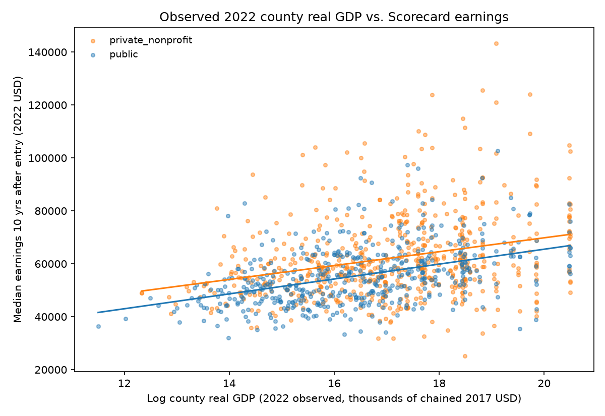

# Appendix: Supporting Descriptive Figures

These figures provide additional views of the data used in [README.md](README.md). The main report presents the research questions, sequential regression results, and cost-efficiency comparison. These descriptive figures show distributions and bivariate relationships.

## A1. Earnings-to-Cost Distribution

Public schools have a higher median nominal earnings-to-cost ratio: 2.12, compared with 1.07 for private nonprofit schools. The groups overlap. Values above the overall 99th percentile are excluded from this plot for display; the main report's medians use the available untrimmed observations.

## A2. Simple Payback Ratios

The median ratio of four-year published cost to annual earnings is 1.89 years for public schools and 3.75 for private nonprofit schools. The boxplot clips values at the overall 99th percentile and hides outlier markers. These ratios do not estimate individual financial break-even dates.

## A3. County Income and Earnings

The fitted lines slope upward for both school groups, with substantial variation among schools at similar county incomes. These are separate bivariate fits by school type. Models 1–4 in the main report examine county income alongside other predictors.

## A4. County GDP Growth and Earnings

The private nonprofit fitted line is nearly flat, while the public line rises modestly. These lines do not hold county income, GDP levels, or college costs fixed. The main report presents the corresponding controlled earnings models and their uncertain growth estimates.

## A5. County GDP Levels and Earnings

The descriptive fitted lines rise with county GDP. The horizontal axis shows the natural logarithm of real GDP measured in thousands of chained 2017 USD. Models 1–5 in the main report include this GDP measure with the other specified predictors.
